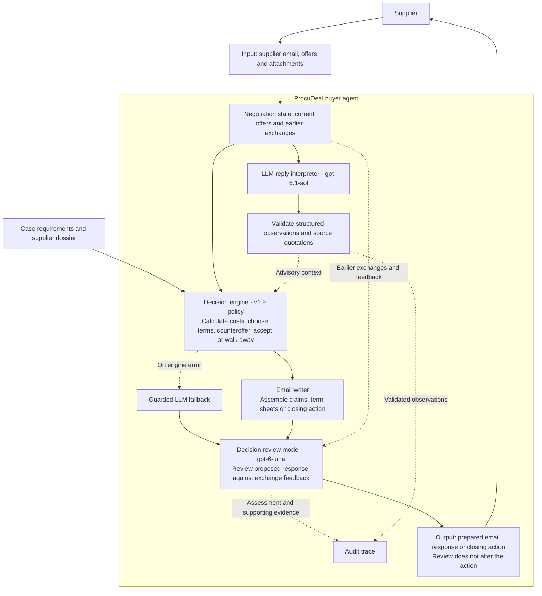

# ProcuDeal

A procurement negotiation agent for the Tacto Negotiation Arena. ProcuDeal calculates total
contract cost, negotiates supplier terms, and decides when to accept or walk away.

**Team:** [@Jaseelkt007](https://github.com/Jaseelkt007) and
[@SiddharthPachpor](https://github.com/SiddharthPachpor).

## Architecture



Both LLM stages are enabled by default and are advisory. The reply interpreter records conditions
and preferences; the reviewer checks the proposed response using previous exchanges. Neither
changes binding terms or acceptance. The deterministic policy controls normal negotiation;
a separate guarded LLM fallback attempts a move if the engine raises an error.

The interpreter has an eight-second deadline per supplier read. The reviewer has an eight-second
total deadline, limited by the remaining 45-second decision budget. An unavailable advisory model
does not block the policy action. Source validation checks provenance, not whether an interpretation is correct.

## Setup

Install Python 3.12 and [uv](https://docs.astral.sh/uv/). From the repository root:

```bash
cd starter-kit
uv sync --all-extras
```

If `.env` does not exist, copy `.env.example` to `.env`. Configure these variables locally;
never commit credentials.

| Variable | Configuration |
|---|---|
| `ARENA_URL` | `https://arena.tacto.ai` |
| `ARENA_API_KEY` | Your team's arena key |
| `ARENA_DATA` | `data/package` |
| `OPENAI_API_KEY` | Key for both advisory models |
| `PROCUDEAL_REPLY_INTERPRETATION` | `on` by default |
| `PROCUDEAL_DECISION_REVIEW` | `on` by default |
| `LLM_PROVIDER`, `LLM_MODEL` | Emergency fallback provider and model; use `.env.example` as the configuration template |
| `ANTHROPIC_API_KEY` or `LLM_API_KEY` | Fallback credential: Anthropic uses the former; OpenAI-compatible providers use the latter |

Download the data and check your team credentials:

```bash
uv run arena data
uv run arena me
```

Keep `data/package` and `data/release-sunday` beside each other. The loader merges the Sunday
release automatically. Run the following commands from `starter-kit/`.

## Run the final

Start this command before the first wave. It waits for cases and runs five waves with up to ten
cases in parallel. **It opens actual final sessions when they become available.**

```bash
mkdir -p logs
uv run arena run --set final --agent procudeal --data data/package \
  --parallel 10 --waves 5 -v > logs/final.log 2>&1
```

Keep the machine powered, awake, and connected. Leave the agent running without human intervention
during the final. Decisions and both advisory model records are written to `logs/final.log`.
Submit the commit hash used for the run and give the jury access to the repository.

## Verification

Run the local tests:

```bash
uv run pytest -q
```

Before the final, this command opens one hosted practice session:

```bash
uv run python scripts/bench.py --agent procudeal case:P08 \
  --data data/package --observe --note final-setup-check
```

The saved combined-model check covered two hosted practice cases and ten concurrent synthetic
cases: 64 buyer decisions, a maximum decision time of 10.35 seconds, and zero thread timeouts.
This measures response preparation, excluding outbound network delivery. It is not a worst-case
guarantee. Hosted outcomes were unchanged; no score improvement from the advisory stages is claimed.

## Detailed documentation

- [Technical solution and implementation](docs/implementation.md#current-submission-pipeline)
- [Evaluation results, limitations, and reproduction commands](evaluations/reply-interpretation/runs/dual-default-report-r01/report.md)
- [Official submission and final-run requirements](brief/submission.md)

Code: [MIT](LICENSE). Data and documentation: [CC BY 4.0](LICENSE-data).
